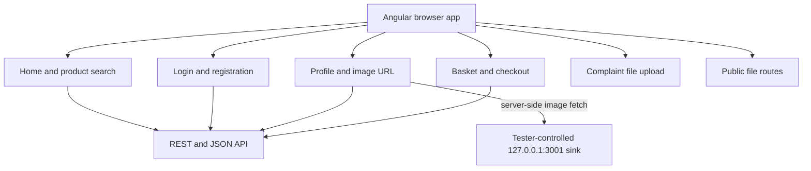

# Local application map

Target: OWASP Juice Shop 20.4.0-SNAPSHOT at `http://127.0.0.1:3000`.

## Observed areas

| Area | Observed route(s) | Notes |
|---|---|---|
| Home/search | `/#/`, `/#/search?q=...` | Search page and query route were mapped during normal browsing; no injection payloads were tested in Week 1. |
| Authentication | `POST /rest/user/login`, `POST /api/Users` | Login and registration routes were mapped from normal synthetic-account flows; no SQL injection payloads were tested in Week 1. |
| Current user | `GET /rest/user/whoami`, `GET /rest/user/whoami?fields=password` | Default response omits password; explicit field request returns the authenticated user's hash. |
| Basket | `GET /rest/basket/{id}`, `POST /api/BasketItems` | Cross-account read confirmed using two synthetic accounts and a tester-created basket item. |
| Profile image URL | `POST /profile/image/url` | Authenticated server-side fetch reached a temporary local mock sink. |
| File upload | `POST /file-upload` | A harmless `.txt` was accepted with 204; no storage or execution impact observed. |
| Public files | `GET /ftp/{file}` | One encoded traversal attempt returned 403. |
| Invalid route handling | `GET /rest/products` | Returned 500 with a stack trace in this local development run; absolute paths redacted in evidence. |

This is the consolidated route map for the four-week lab assessment. Week 1 itself covered baseline mapping and normal flows only; later-week findings and dates are recorded in their Week 2/3 evidence. It is not a claim of complete endpoint coverage.
