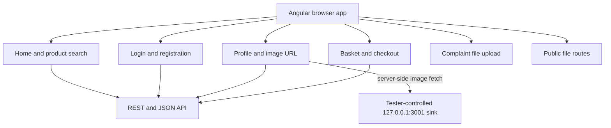

# Local application map

Target: OWASP Juice Shop 20.4.0-SNAPSHOT at `http://127.0.0.1:3000`.
Verified 2026-11-28 on a fresh local instance: `GET /` 200, `GET /rest/admin/application-version` 200.

## Observed areas

| Area | Observed route(s) | Notes |
|---|---|---|
| Home/search | `/#/`, `/#/search?q=...`, `GET /rest/products/search?q=...` | Search query is rendered as HTML; DOM XSS confirmed in local browser (F-03). Empty `q=` returns all products (46 on 2026-11-28); `q=apple` returns 3 products. |
| Authentication | `POST /rest/user/login`, `POST /api/Users` | Login response contains a JWT; SQLi bypass confirmed against the local lab only (F-02). |
| Current user | `GET /rest/user/whoami`, `GET /rest/user/whoami?fields=password` | Default response omits password; explicit field request returns the authenticated user's hash (F-06). **Cookie token is required** — `Authorization: Bearer` alone returns an empty user object (verified 2026-11-28). |
| Admin info | `GET /rest/admin/application-version`, `GET /rest/admin/application-configuration` | Reachable without login. Version returns `20.4.0-SNAPSHOT`; configuration returns application config. Recorded as inventory only, not scored as a finding. |
| Basket | `GET /rest/basket/{id}`, `POST /api/BasketItems` | Cross-account read confirmed using two synthetic accounts and a tester-created basket item (F-05). |
| Product reviews | `GET /rest/products/{id}/reviews` | Returns reviews without login; review authors include seeded user emails (e.g. `admin@juice-sh.op`). |
| Profile image URL | `POST /profile/image/url` | Authenticated server-side fetch reached a temporary local mock sink (F-04). |
| File upload | `POST /file-upload` | A harmless `.txt` was accepted with 204; no storage or execution impact observed. |
| Public files | `GET /ftp/{file}` | One encoded traversal attempt returned 403. |
| Invalid route handling | `GET /rest/products` | Returned 500 with a stack trace in this local development run; absolute paths redacted in evidence (F-01). |

This map records observed lab routes only; it is not a claim of complete endpoint coverage.
