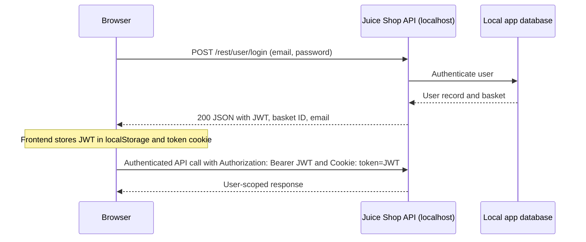

# Authentication and session flow observed

## Observations

- A normal synthetic-account login returned HTTP 200.
- Login returned a JWT in the JSON body. The frontend stores it in `localStorage` and in a `token` cookie; requests may carry it in both the `Authorization: Bearer` header and cookie.
- Follow-up verification on 2026-11-28 found that `GET /rest/user/whoami` requires the cookie to identify the user. The Bearer header alone returned an empty user object; both header and cookie returned the synthetic account fields.
- Logging in twice issues different tokens. No token value was saved in the evidence pack.

This Week 1 note documents the normal session flow and a later reproducibility correction. Security testing results are documented in the later-week materials.

## Flow diagram limits

This is a summarized local flow, not a browser-proxy transcript. The Burp native project remains pending in Community edition.
