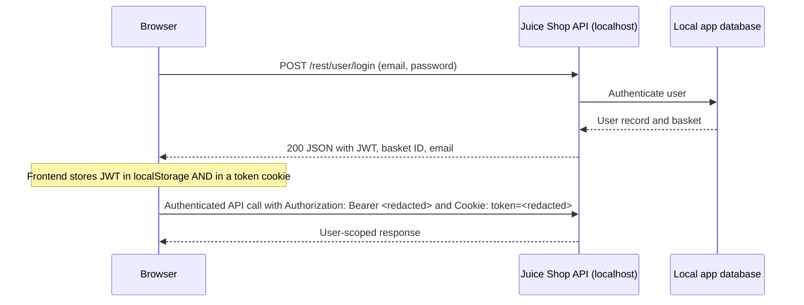

# Authentication and session flow observed

## Observations

- Valid synthetic-account login returned HTTP 200. A nonexistent synthetic user returned 401.
- Login returned a JWT in the JSON body (`authentication.token`), plus basket ID (`bid`) and email (`umail`). The frontend stores it in `localStorage` and in a `token` cookie, and later requests carry it in both places: `Authorization: Bearer` header and `Cookie: token=`.
- **Cookie is the effective auth for `/rest/user/whoami`.** Verified 2026-11-28 on a fresh local instance with a synthetic account: `GET /rest/user/whoami` with `Authorization: Bearer` alone returned 200 with `{"user":{}}` (empty); the same request with the `Cookie: token=` header added returned the user fields. The original flow file did not state this — without the cookie the whoami check is not reproducible.
- A local DOM XSS payload could read the token from `localStorage` without sending it anywhere.
- After the test cleared the browser's token storage and cookie, replaying the same in-memory token still authenticated the synthetic account (HTTP 200). The app's signing code sets a six-hour token expiry; this test did not wait for expiry.
- Logging in twice issues different tokens. No token value was saved in the evidence pack.
- A modified token was not used to access protected account data in this run; signature-tampering and fixation coverage remains incomplete.
- The authenticated user's ordinary `whoami` response omitted the password property. Asking explicitly for `fields=password` returned the authenticated account's hash; the value is redacted, and no other user's hash was requested.

## Flow diagram limits

This is a summarized local flow, not a browser-proxy transcript. The Burp native project remains pending in Community edition.
