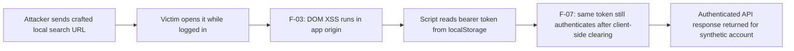

# Evidence-backed attack chain

## Evidence table

| Step | Finding ID | Preconditions | Evidence | Impact demonstrated | Confidence |
|---|---|---|---|---|---|
| 1 | F-03 | Victim opens crafted search URL | week2/evidence/F-03/dom-xss-executed.png | Script executes in page origin | Confirmed |
| 2 | F-03 | Victim is logged in | week3/evidence/F-07/xss-session-chain.png | Script can read localStorage token; value not captured or sent away | Confirmed |
| 3 | F-07 | Previously issued synthetic token is available to the test harness | week3/evidence/F-07/session-replay.json | API returned HTTP 200 after browser token/cookie were cleared | Confirmed |

This chain was reproduced only with a synthetic account in the local lab. No token was exfiltrated. The response checked was the same synthetic account's email field. The test did not wait for token expiry.

The SQL injection finding independently established a seeded administrator login. It is not combined with the XSS chain because no additional cross-finding transition was needed to demonstrate the impact.
